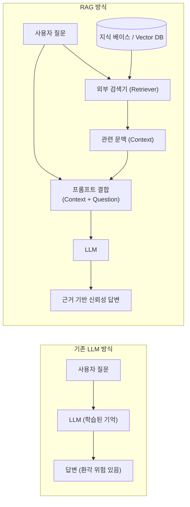
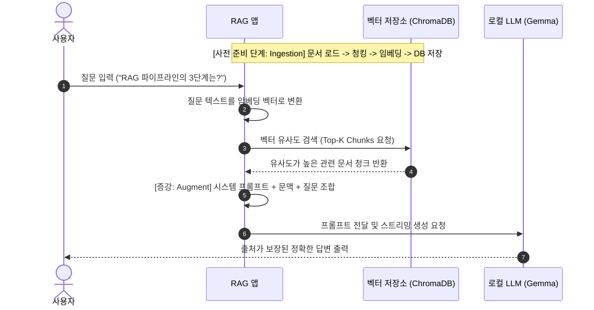

# 01. RAG(Retrieval-Augmented Generation) 개요 및 필요성

## 1. RAG란 무엇인가?
**RAG(Retrieval-Augmented Generation, 검색 증강 생성)**는 대규모 언어 모델(LLM)이 답변을 생성할 때, 사전 학습된 가중치(Parametric Memory)에만 의존하지 않고 **외부 지식 베이스(Non-Parametric Memory)에서 질문과 관련된 정보를 실시간으로 검색(Retrieval)하여 이를 참고 자료로 답변을 생성(Generation)하는 아키텍처**입니다.

---

## 2. 왜 RAG가 필요한가? (LLM의 3대 한계와 극복)

### ① 환각 현상 (Hallucination) 억제
- **문제**: LLM은 통계적으로 가장 그럴듯한 다음 단어를 예측하는 확률 모델이므로, 모르는 내용도 마치 사실인 것처럼 거짓 정보를 지어냅니다.
- **해결**: RAG는 명확한 출처 문서(Ground Truth Context)를 프롬프트에 직접 주입하여, "주어진 문서에 기반해서만 답변하라"고 제약할 수 있습니다.

### ② 지식의 최신성 및 사내 비공개 데이터 활용
- **문제**: LLM은 학습 컷오프(Knowledge Cutoff) 시점 이후의 사건이나 회사의 사내 규정, 기밀 매뉴얼, 개인 문서를 알 수 없습니다.
- **해결**: 문서를 벡터 DB에 넣기만 하면 모델을 다시 학습시키지 않고도 1초 만에 최신 지식을 반영할 수 있습니다.

### ③ 비용 및 유지보수 효율성
- **문제**: 새로운 지식을 반영하기 위해 매번 모델을 파인튜닝(Fine-tuning)하는 것은 막대한 컴퓨팅 파워와 데이터 정제 비용이 듭니다.
- **해결**: RAG는 파인튜닝 대비 비용이 거의 들지 않으며, 내용 수정이 필요할 경우 벡터 DB에서 해당 문서만 교체하면 즉시 갱신됩니다.

---

## 3. RAG 파이프라인의 3단계 흐름

1. **Ingestion (인입 및 인덱싱)**: 원본 문서(TXT, PDF 등)를 적절한 크기로 쪼개고(Chunking) 임베딩 벡터로 변환하여 벡터 DB에 영구 저장합니다.
2. **Retrieval (검색)**: 사용자의 질문을 같은 임베딩 모델로 벡터화한 뒤, 벡터 DB에서 코사인 유사도가 가장 높은 상위 $K$개의 조각을 찾아옵니다.
3. **Generation (증강 및 생성)**: 찾아온 문서 조각들을 질문과 합쳐 LLM에 전달하고, LLM이 문맥을 근거로 삼아 최종 답변을 생성합니다.
